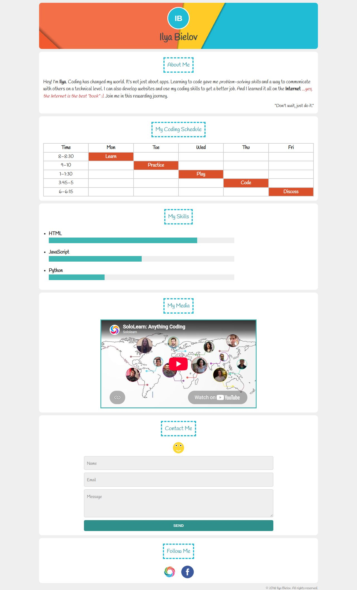
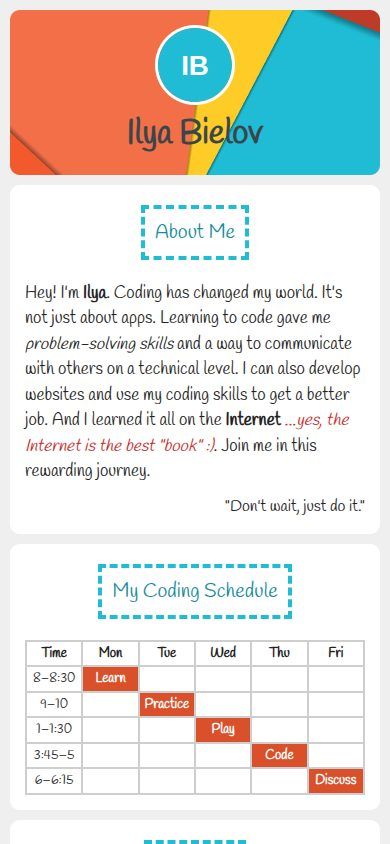

# About Me — SoloLearn HTML project

A one-page personal "About Me" site, built as the final project of the
[SoloLearn](https://www.sololearn.com/) HTML course (2018). Plain HTML and CSS, no JavaScript.

## Screenshots

<table>
  <tr>
    <th>Desktop (1280 px)</th>
    <th>Phone (390 px)</th>
  </tr>
  <tr>
    <td valign="top"></td>
    <td valign="top"></td>
  </tr>
</table>

## What's on the page

- Header with an avatar and a name
- About me, with a quote
- Weekly coding schedule as a table
- Skills as progress bars
- An embedded YouTube video
- Contact form with an inline SVG smiley
- Social links

## Run it

Open `index.html` in a browser, or serve the folder locally:

```bash
python3 -m http.server 8000
# → http://localhost:8000
```

## Structure

```
.
├── index.html
├── style.css
├── images/                 # Avatar, header background, social icons
└── docs/screenshots/       # Screenshots for this README
```

## What it practices

- Basic HTML: headings, paragraphs, text formatting, lists, links, images
- Tables with header cells (`th scope`), `progress`, `iframe`, inline SVG
- Forms with labels and validation (`required`, `type="email"`)
- CSS: box model, borders, backgrounds, a schedule table and a video that fit on phones

## Notes

- The form is not wired to a backend.
- The header background and the SoloLearn/Facebook icons come from the SoloLearn course template.

Made by [Ilya Bielov](https://www.facebook.com/MrBiela).
